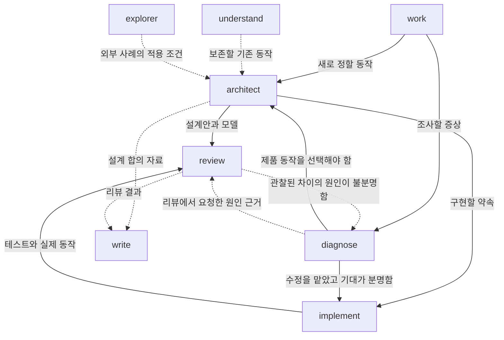

# Loom

Loom은 Claude Code와 Codex에서 소프트웨어 작업을 수행하는 플러그인입니다. 사용자가 확인할 수 있는 시나리오를 기준으로 조사하고 설계하며, 구현 결과를 검증합니다.

[English](README.md) | [한국어](README.ko.md)

## 설치와 사용

Claude Code:

```bash
claude plugin marketplace add grapgrap/loom
claude plugin install loom@loom-marketplace
```

Codex:

```bash
codex plugin marketplace add grapgrap/loom
codex plugin add loom@loom-marketplace
```

설치한 스킬을 사용할 수 있도록 새 세션을 시작합니다. Claude Code에서는 `/loom:work`, Codex에서는 `$loom:work`로 호출할 수 있습니다.

## 스킬

| 스킬                                             | 역할                                                                       |
| ------------------------------------------------ | -------------------------------------------------------------------------- |
| [`$loom:work`](skills/work/SKILL.md)             | 완료 조건을 정하고 필요한 스킬을 연결해 요청한 결과를 확인합니다.          |
| [`$loom:understand`](skills/understand/SKILL.md) | 기존 코드에서 도메인의 책임과 협력 흐름을 설명합니다.                      |
| [`$loom:diagnose`](skills/diagnose/SKILL.md)     | 보고된 증상을 재현하고 근거를 바탕으로 원인을 좁힙니다.                    |
| [`$loom:explorer`](skills/explorer/SKILL.md)     | 제품·문서·구현 사례로 질문을 좁히고 방법과 적용 조건을 찾습니다.           |
| [`$loom:architect`](skills/architect/SKILL.md)   | TypeScript로 도메인을, TLA+와 TLC로 흐름을 검증하며 설계를 합의합니다.     |
| [`$loom:implement`](skills/implement/SKILL.md)   | 시나리오 하나씩 Red → Green → Refactor로 구현하고 검증합니다.              |
| [`$loom:review`](skills/review/SKILL.md)         | 테스트가 빠뜨리거나 추가한 조건을 찾고 실제 구현의 책임 경계를 확인합니다. |
| [`$loom:write`](skills/write/SKILL.md)           | 독자와 목적에 맞게 설명과 문서를 작성하고 다듬습니다.                      |

### 스킬은 어떻게 이어지나요?

`work`는 사용자의 완료 조건을 기준으로 다음 작업을 고릅니다. 새 동작을 정하려면 `architect`에서 사용자와 글과 그림을 보며 합의합니다. 사용자 제보나 실패한 테스트의 원인을 묻는 요청은 `diagnose`에서 바로 조사합니다. 재현만 요청했다면 같은 조건에서 다시 확인할 방법과 관찰 결과로 마칩니다.



`understand`는 기존 사용처가 의존하는 동작을 확인하고, `explorer`는 외부 사례의 어떤 전제가 이번 선택에 영향을 주는지 조사합니다. `write`는 설계와 리뷰의 판단을 같은 업무 용어로 다듬습니다. `work`는 그 결과를 처음의 완료 조건과 대조해 확인한 범위와 남은 결정을 사용자에게 전달합니다.

## 2.x에서 옮기기

레퍼런스 탐색 호출을 `$loom:explore`에서 `$loom:explorer`로 바꾸세요. 동작 변경은 `$loom:work`에서 시작합니다. 결함 재현과 원인 조사는 `$loom:diagnose`가 맡습니다. 수정을 요청했고 기존 계약이 분명하면 `$loom:implement`가 그 동작을 회복합니다. 새 계약이나 책임 변경이 필요하면 먼저 `$loom:architect`로 설계합니다. 3.0은 독립 스킬 `$loom:verify`, `$loom:coordinate`, `$loom:orchestrate`를 제거했습니다.
