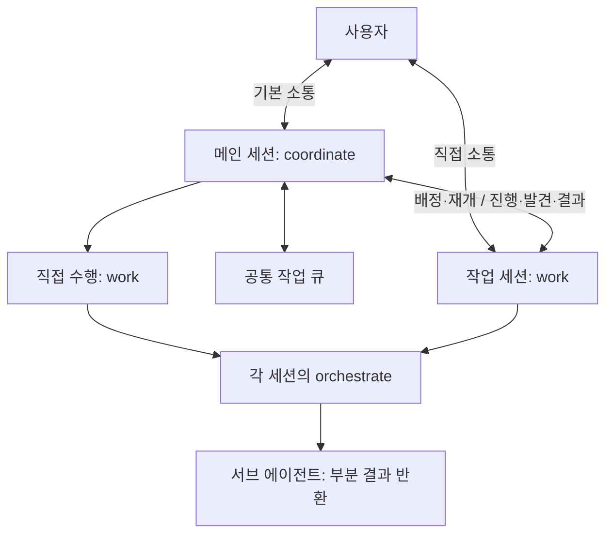

# Loom

AI에게 작업을 맡길 수 있는 신뢰를 쌓기 위한 Claude Code와 Codex에서 사용하는 플러그인입니다. 현재 설계를 이해하고, 근거에 따라 변경하며, 실제 결과를 확인할 수 있게 합니다.

v2는 [pstack](https://github.com/cursor/plugins/tree/main/pstack)의 작업별 경로 선택과 실제 결과 중심의 검증에서 영감을 받았습니다. 스킬과 템플릿은 Loom의 목적에 맞춰 새로 작성했습니다.

이 버전은 신뢰를 쌓아갈 시작점입니다. 실제 작업에서 발견한 판단, 실행과 검증에서 발생한 실패를 고치고 다시 확인하며 맡길 수 있는 범위를 넓혀갑니다. 장기적인 자율 작업은 그 개선이 쌓여 도달할 방향입니다.

[English](README.md) | [한국어](README.ko.md)

## 작업마다 필요한 과정만 거칩니다

Loom v2는 `shape → plan → task` 같은 고정 순서를 요구하지 않습니다. `work`가 사용자가 원하는 결과를 기준으로 [실행 경로](skills/work/references/change-routes.md)를 선택합니다. 결함은 재현과 원인부터, 성능 문제는 측정부터, 동작을 보존하는 재구성은 변경 전 동작부터 시작합니다. 책임이나 계약의 중요한 변경에는 `architect`를 적용합니다.

조사에서 확인한 제약은 설계로, 설계에서 보존할 조건은 구현과 검증으로 이어집니다. 각 단위의 결과를 확인하고, 최종 변경을 정리한 뒤 맡긴 전달 지점까지 진행합니다. 실패나 미확인이 남으면 그 조건과 근거를 알립니다.

작업이 크다는 이유만으로 사용자의 승인을 기다리지 않습니다. 조사나 실험으로 답할 수 있는 의문은 직접 확인합니다. 도메인의 의미, 제품 정책, 사용자 경험이나 외부 계약에 관해 사람의 선택이 남거나 사용자가 사전 검토를 요청했다면, 그 선택에 의존하는 구현을 멈추고 대안과 영향을 보여줍니다.

## 스킬

| 스킬                                     | 역할                                                                                                       |
| ---------------------------------------- | ---------------------------------------------------------------------------------------------------------- |
| [coordinate](skills/coordinate/SKILL.md) | 작업 큐와 지속 작업 세션의 배정, 재개, 의존 관계와 결과 수락, 사용자 소통을 조율합니다.                    |
| `work`                                   | 맡은 작업의 조사, 설계, 구현과 검증을 수행하고, 새 작업을 발견하고 후속 요청으로 이어갑니다.               |
| `orchestrate`                            | 한 세션 안에서 같은 워크트리의 서브 에이전트에게 부분 업무를 배정하고 결과를 수락합니다.                   |
| `understand`                             | 코드, 실행 결과와 이력으로 현재 그림을 재구성해 판단의 출발점을 제공합니다. 독립 호출은 조사와 보고입니다. |
| `explore`                                | 레퍼런스로 질문을 구체화하고 작동 원리와 적용 조건을 도출해 설계 후보를 전달합니다.                        |
| `architect`                              | 도메인과 책임, 경계를 발견하고 협력 관계와 계약을 설계하며 독립적인 세부 설계의 범위를 도출합니다.         |
| `verify`                                 | 구현 전에 테스트나 임시 검증 도구를 준비하고, 수행 중과 완료 후 실제 결과로 완료 조건을 판정합니다.        |
| `review`                                 | 산출물과 증거에 반례를 대입해 판단과 검증의 빈틈을 찾고, 지적 자체도 검증합니다.                           |
| `write`                                  | 문제, 근거, 판단과 결론을 연결해 문서를 작성하고, 의미와 제약을 보존하며 표현을 다듬습니다.                |

설명, 설계, 검증이나 검토만 요청한 경우에는 그 범위에서 결과를 전달합니다. 구현과 수정은 맡긴 작업의 범위 안에서 진행합니다.

`explore`는 무엇을 조사할지 불명확한 상황에서도 시작합니다. 사례를 조사하고 원리를 현재 문제에 대입하며 질문을 발전시킵니다. 적용 후보와 선택 조건을 설계로 전달하며, 문제 재정의나 판단 유보도 근거와 함께 반환합니다. 긴 탐색은 달라진 전제, 원본 근거와 남은 질문을 대화나 필요한 실행 계획에 남겨 이어갑니다. 접근과 적용 조건이 이미 알려진 변경에는 별도 탐색을 요구하지 않습니다.

`architect`는 작업 분해나 도메인 목록이 없는 요청에서도 핵심 사용 흐름을 따라 책임과 경계, 협력 관계를 발견합니다. 메인에서는 전체 설계를, 작업 세션에서는 세부 설계를 다루고, 경계가 드러난 영역부터 독립적으로 진행할 수 있게 합니다. 공통 계약을 바꿀 근거가 나오면 영향을 받는 설계와 작업을 함께 조정합니다. 작은 변경은 기존 경계와 계약을 재사용합니다.

`verify`는 구현 전에 검증 기준과 실행 수단을 준비할 때도 사용합니다. 기존 검사를 재사용하고 부족한 부분에 테스트나 임시 검증 도구를 만든 뒤 실제로 실행해 변경 전 실패나 기준값을 확보합니다. 준비만 요청받았다면 검사와 실행 방법을 인계하고, 제품 동작의 구현은 맡긴 범위에 따라 진행합니다.

`work`는 맡은 작업을 수행하는 기본 경로입니다. 지속적인 작업 세션 간 조율에는 `coordinate`를, 세션 내부의 서브 에이전트 협업에는 `orchestrate`를 사용합니다. 전문 스킬은 각 세션과 서브 에이전트에서 맡은 목적에 따라 사용합니다.

글을 작성하거나 검토할 때는 `write`를 적용합니다. `write`는 요청 범위와 전달을 맡고, 모든 글에 [명확한 표현](skills/write/references/clarity.md)의 기준을 적용합니다. 문제와 판단의 논리를 구성, 검토할 때는 [문서 프레이밍](skills/write/references/framing.md)도 적용합니다. 단순 교정과 요약에서는 원문의 방향과 판단을 보존합니다.

## 지속적인 작업 세션을 조율합니다

메인 세션은 여러 개 유지할 수 있고, 각 메인은 작업 세션을 0개 이상 둡니다. `coordinate`는 아직 분해되지 않은 일의 구체화와 전체 설계를 진행하면서 발견한 하위·형제 작업을 공통 큐에 연결합니다. 선행 조건이 충족된 작업 중 우선순위에 따라 직접 수행하거나 기존 작업 세션에 넘기거나 새 세션에 배정합니다. 하위 작업을 조율하는 작업 세션은 그 범위에서 메인 역할을 맡습니다.

관련 세션은 [공통 작업 기록](references/task-record.md)의 같은 원본을 사용합니다. 목표와 완료 조건, 부모와 의존 관계, 우선순위, 조정 책임자와 담당 세션, 산출물과 검증 근거를 연결합니다. 공유 기록은 세션 외부에 두며, 파일이 필요하면 [실행 계획](templates/execution-plan.md)을 사용할 수 있습니다. 실행 가능 여부는 선행 결과와 필요한 입력에서 판단하고, 호스트의 실행 상태와 작업 결과의 수락은 구분합니다.

사용자는 기본적으로 메인과 소통하면서 작업 세션의 대화에도 직접 참여할 수 있습니다. 직접 정한 범위나 공통 계약, 우선순위의 변경은 공통 기록과 관련 작업에 반영합니다. 작업 기록에서 원본 대화, 진행 상태, 산출물과 검증 근거를 찾아갈 수 있게 합니다.



작업 세션은 결과 제출 뒤에도 대화와 작업 맥락을 유지하며 후속 요청으로 재개합니다. PR 이후 CI나 리뷰 대응과 최종 정리는 맡긴 전달 지점에 따릅니다. 서브 에이전트는 호출 세션에 결과를 반환하면 해당 위임을 마칩니다.

Loom은 이 판단과 보고 지침을 제공합니다. 독립 세션 생성, 메시지 전달, 대기와 재개, 지속 실행은 호스트가 실제로 제공하는 도구와 사용자·프로젝트의 권한을 따릅니다. 필요한 기능이 없는 환경에서는 해당 제약과 가능한 범위를 알리며, 독립 작업 세션을 단발성 서브 에이전트로 대체하지 않습니다.

## 세션 안에서 서브 에이전트를 조율합니다

멀티 에이전트 협업을 요청하면 호출 세션의 조율자가 `orchestrate`로 맡은 범위의 계획을 세웁니다. 완료 조건에서 부분 업무를 도출하고, 각 업무의 기여 조건, 범위, 담당, 의존 관계와 실행 순서를 정하고 통합 및 검증을 정합니다. 완료 조건에는 관찰할 결과와 확인 방법, 기대 결과와 제출할 증거를 연결합니다. 서브 에이전트인 작업자는 `work`로 맡은 범위의 세부 계획, 수행과 검증을 담당합니다. 실행할 모델은 사용자와 프로젝트의 정책을 따르며, 정해진 선택이 없으면 첫 실행 전에 확인합니다.

조율자는 같은 워크트리에서 동시에 수정할 파일이 겹치지 않게 담당을 나누고, 선행 결과가 필요한 작업과 공통 파일의 수정 순서를 정합니다. 각 작업자에게 범위, 완료 조건, 필요한 맥락과 보고 규약을 전달합니다. 작업자는 정한 중간 결과와 막힘과 전제 변경을 보고합니다. 조율자는 실행 상태와 조건별 확인 결과, 근거와 남은 일을 대조하고, 점검 결과에 따라 계획을 갱신해 후속 업무나 보완을 배정합니다. 범위나 완료 조건의 변경과 추가 위임, 작업 간 조정은 조율자가 맡습니다.

서브 에이전트는 [수행 지침](skills/work/references/delegated-work.md)에 따라 명세와 원본 근거를 읽고, 관찰과 산출물 및 남은 일을 호출 세션으로 반환합니다. 지속 작업 세션에는 별도의 [세션 수행 지침](skills/work/references/delegated-session.md)을 적용합니다. 조율자는 현재 명세와 실제 산출물을 대조해 완료 조건을 충족한 결과를 수락하고, 부족한 조건은 근거와 함께 보완을 요청합니다. 맡은 업무는 하위 결과의 수락과 합쳐진 동작의 검증을 확인한 뒤 완료합니다.

## 이해는 제공하고 문서는 선별합니다

의미 있는 변경에서는 현재 동작과 변경 후의 그림, 보존할 조건과 선택 이유를 대화에서 설명합니다. 이 그림을 프로젝트별 영속 설계 문서로 자동 저장하지 않습니다.

- 작업 중 설명은 현재 작업의 이해를 위해 사용합니다.
- PR과 커밋 설명은 당시의 선택과 검증을 남기는 역사 기록입니다.
- 이후에도 누군가 의존하는 사용법, 외부 계약과 검증 절차만 계속 갱신할 문서로 만듭니다.

파일이 필요한 다단계 작업에는 [실행 계획 템플릿](templates/execution-plan.md)을, 반복 가능한 실제 검증 경로가 필요할 때에는 [검증 절차 템플릿](templates/verification-recipe.md)을 사용할 수 있습니다. 단순한 작업에 두 템플릿을 만들 필요는 없습니다.

## 저장소 구조

```text
scripts/check-plugin.ts  플러그인 메타데이터와 문서 참조 검사
skills/                  에이전트 작업 지침
references/              세션 간 공통 작업 기록과 보고 규약
templates/               계획과 검증 문서 템플릿
```

## 스킬을 개선하고 확인하기

실제 작업에서 관찰한 실패와 누락을 근거로 지침이나 실행 수단을 고칩니다. 변경 후 같은 조건에서 결과가 나아졌는지 확인합니다. 형식 검사는 스킬의 판단이나 실행 효과를 증명하지 않습니다.

공통 판단은 담당 스킬에 두고 조건부 절차는 읽을 시점을 명시한 참조로 분리합니다. 권한과 실패 규칙은 해당 행동 전에 보이게 둡니다. 적용 조건, 출처와 완료 판단은 스킬에 보존합니다. 변경 전 사본과 수정본을 미리 정한 사례로 비교하고, 에이전트 평가가 허용됐다면 새 세션과 스킬 없는 조건을 사용합니다. 파일 크기만으로 실제 읽기 비용이나 행동 품질을 판정하지 않습니다. 읽은 참조, 결과, 도구 오류와 미확인을 기록하며 고정 압축률을 강제하지 않습니다.

스크립트는 TypeScript(`.ts`)로 작성하고 import에 `.ts` 확장자를 명시합니다. 실행 시 제거 가능한 타입 문법을 사용하며 개발 도구는 Node.js 22.18 이상인 22.x, 24.x 또는 26 이상을 지원합니다. 개발 의존성은 `package.json`에 고정한 Yarn 버전과 `pnpm` 노드 링커를 사용합니다. 각 클론에서 의존성을 설치하고 Git 훅을 한 번 설정합니다.

```bash
yarn install --immutable
yarn hooks:install
```

TypeScript로 타입을 검사하고 Oxlint로 린트, Oxfmt로 소스, 설정과 Markdown의 형식을 통일합니다. 과거 기록인 `.loom/`은 제외합니다. Lefthook은 커밋 전에 저장소 전체의 타입, 린트와 포맷 및 플러그인 구조와 문서 참조를 검사하며 파일을 수정하거나 스테이징하지 않습니다. `yarn lint:fix`와 `yarn format`으로 수정한 뒤 커밋할 변경을 직접 스테이징합니다.

전체 검사는 `yarn validate`로 실행합니다. 타입, 린트, 포맷과 플러그인 검사를 차례로 실행하며, 실패하면 멈춥니다. 필요한 검사만 실행할 수도 있습니다.

```bash
yarn lint
yarn format:check
yarn check
yarn typecheck
```

`yarn typecheck`는 `scripts`를 엄격한 TypeScript 설정으로 검사하며 파일을 생성하지 않습니다. Node 직접 실행은 타입을 제거할 뿐 검사하지 않으므로 커밋 훅에서도 린트, 포맷과 함께 타입 검사를 실행합니다.

`yarn check`는 메타데이터, 설정의 일치, 로컬 파일과 제목 참조를 확인합니다.

실제 작업에서는 목표와 범위를 지켰는지, 필요한 확인을 수행했는지, 결과에 증거가 있는지를 과정과 산출물에서 확인합니다. 스킬 적용 과정의 설명만으로 성공을 판정하지 않습니다.

## 설치와 사용

Claude Code:

```bash
claude plugin marketplace add grapgrap/loom
claude plugin install loom@loom-marketplace
```

Codex:

```bash
codex plugin marketplace add grapgrap/loom
codex plugin add loom@loom-marketplace
```

설치한 스킬을 사용할 수 있도록 새 세션을 시작합니다. Claude Code에서는 `/loom:work`, Codex에서는 `$loom:work`로 호출할 수 있습니다.

```text
/loom:work 재시도 후 알림이 두 번 발송됩니다. 재현하고 원인을 고친 뒤 같은 경로에서 확인해 주세요.
$loom:coordinate 에이전트 실행 엔진의 도메인과 경계부터 발견하고, 필요한 작업 세션을 만들어 세부 설계를 나누어 진행해 주세요. 발견한 하위·형제 작업의 우선순위와 의존 관계도 조율해 주세요.
$loom:orchestrate 이 변경을 같은 워크트리에서 여러 에이전트에게 나누어 맡기고 결과를 검증해 주세요.
$loom:explore 장시간 작업의 재시도 경험을 개선하고 싶은데 무엇을 참고할지부터 탐색해 주세요. 설계는 아직 하지 마세요.
$loom:architect 이 기능의 현재 책임과 변경 후 사용자 경험을 먼저 보여주세요. 구현은 하지 마세요.
$loom:understand 결제 실패가 지금 어떻게 처리되고 왜 이렇게 되었는지 설명해 주세요.
$loom:write 이 설계 제안의 문제, 근거, 판단과 적용 범위를 연결하고 표현을 다듬어 주세요.
```

## v1에서 옮기기

v1의 `propose`, `shape`, `plan`, `task`, `calibrate`는 v2에서 호출명으로 유지하지 않습니다. 보통의 변경은 `work`, 현재 설계의 이해는 `understand`, 설계만 필요한 경우는 `architect`를 사용합니다. 다단계 계획은 필요할 때 `work`가 만들며, 검토는 `review`로 계속할 수 있습니다.

기존 프로젝트의 `.loom/` 문서는 삭제하거나 자동 변환하지 않습니다. v2는 이를 필요할 때 참고할 역사 자료로 취급하며, 계속 최신으로 유지할 의무를 새로 부여하지 않습니다.
