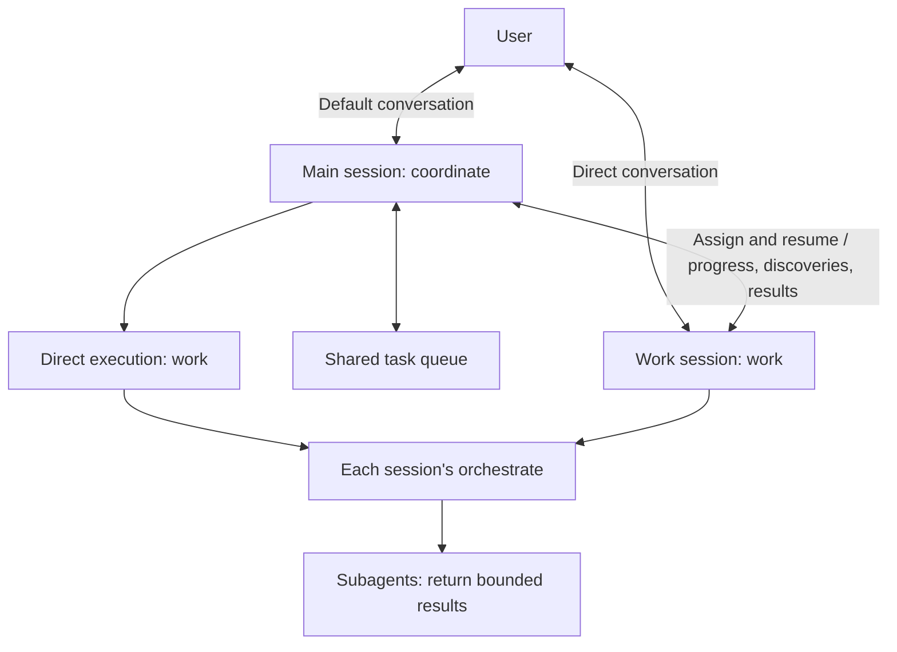

# Loom

Loom is a Claude Code and Codex plugin for building trust in work entrusted to AI. It grounds decisions in the current system, guides changes, and makes their results checkable.

V2 draws on [pstack](https://github.com/cursor/plugins/tree/main/pstack)'s task-sensitive routing and real-outcome verification. Its skills and templates were written anew for Loom's goals.

This version is a starting point. Real tasks expose failures in judgment, execution, and verification. Fixing and rechecking those failures expands what can be entrusted to the agent. Sustained autonomous work is a direction to grow toward through those improvements.

[English](README.md) | [한국어](README.ko.md)

## Choose the process the task needs

Loom v2 does not require a fixed `shape → plan → task` sequence. `work` selects an [execution route](skills/work/references/change-routes.md) from the outcome the user wants. A defect starts with reproduction and cause. A performance issue starts with a measurement. A behavior-preserving refactor starts by recording the current behavior. A change to responsibilities or contracts calls for `architect`.

Constraints found during investigation inform the design. Contracts chosen in the design carry through implementation and verification. Each unit ends in a check, the final diff gets cleaned, and work reaches the delivery point the user requested. Failures and inconclusive checks retain their conditions and evidence.

Size alone does not require human approval. Questions that observation or an experiment can settle should be investigated. If a domain, product, experience, or external-contract choice remains for a person to make, or the user asks to review the design first, Loom shows the options and effects before dependent implementation proceeds.

## Skills

| Skill                                    | Responsibility                                                                                                                   |
| ---------------------------------------- | -------------------------------------------------------------------------------------------------------------------------------- |
| [coordinate](skills/coordinate/SKILL.md) | Coordinate a task queue, persistent work sessions, dependencies, acceptance, and communication with the user.                    |
| `work`                                   | Investigate, design, implement, and verify assigned work; report discovered tasks and continue with follow-up requests.          |
| `orchestrate`                            | Assign bounded work to subagents within one session and worktree, then review and accept their results.                          |
| `understand`                             | Reconstruct the current picture from code, runtime evidence, and history. Direct invocation investigates and reports.            |
| `explore`                                | Refine questions through references, derive mechanisms and applicability conditions, and return design candidates.               |
| `architect`                              | Discover domains, responsibilities, and boundaries; design collaboration and contracts; identify independently designable areas. |
| `verify`                                 | Prepare tests or temporary verification tools before implementation, then check actual outcomes during and after it.             |
| `review`                                 | Find gaps in decisions and evidence through counterexamples, then check the findings themselves.                                 |
| `write`                                  | Connect problems, evidence, judgments, and conclusions; refine wording while preserving meaning and constraints.                 |

Requests for explanation, design, verification, or review stay within that scope. Implementation and fixes follow the scope of the work entrusted to the agent.

`explore` can start before the research question is clear. It investigates examples, applies their mechanisms to the current problem, and revises its questions. It hands candidates and selection conditions to design, or returns reasons to redefine the problem or defer judgment. Long explorations retain changed assumptions, source evidence, and remaining questions in the conversation or an execution plan when needed. Changes with known approaches and applicability conditions do not require a separate exploration.

`architect` can start without a domain inventory or decomposed tasks. It follows the core use flow to discover responsibilities, boundaries, and collaboration. Main sessions work on the overall design, while work sessions refine their assigned areas. Areas with clear boundaries can proceed independently; evidence that changes a shared contract returns to the affected design and work. Small changes reuse existing boundaries and contracts.

Use `verify` before implementation to define verification criteria and prepare executable checks. Reuse existing checks, add tests or temporary verification tools where needed, and run them to capture an expected failure or baseline. When only preparation is requested, hand over the checks and execution instructions; implementing product behavior remains subject to the assigned scope.

`work` is the default route for carrying out assigned work. Use `coordinate` for persistent work sessions and `orchestrate` for subagent collaboration inside a session. Specialized skills remain available in any session or subagent according to its assigned purpose.

Use `write` when writing or reviewing prose. `write` owns scope and delivery, applies [clarity criteria](skills/write/references/clarity.md) to all prose, and adds [document framing](skills/write/references/framing.md) when the request involves building or reviewing the reasoning. Editing and summarization preserve the source's direction and judgments.

## Coordinate persistent work sessions

Several main sessions can coexist, each with zero or more work sessions. `coordinate` helps clarify an undecomposed goal and its overall design, connecting discovered child and sibling tasks to a shared queue. It selects ready work by priority, performs it directly, reuses a related work session, or assigns a new one. A work session coordinating its own children acts as their main session within that scope.

Related sessions use one source of [shared task records](references/task-record.md). Records connect goals, acceptance criteria, parents and dependencies, priority, coordinating and executing owners, session references, artifacts, and verification evidence. Keep the shared record outside a session's conversation; use the [execution-plan template](templates/execution-plan.md) when a shared file is needed. Derive readiness from accepted dependencies and required inputs, and distinguish host execution status from acceptance of a task's result.

Users normally communicate through the main session and can also enter a work session directly. Decisions that change scope, shared contracts, or priority flow back to the shared record and affected work. The task record links to the original conversation, progress, artifacts, and verification evidence.



Work sessions retain their conversations and task context after submitting results and can resume for related requests. CI fixes, review responses after a PR, and final cleanup follow the assigned delivery point. Subagents finish their assignment after returning results to the calling session.

Loom provides the decision and reporting instructions. Independent session creation, messaging, waiting, resumption, and persistent execution depend on actual host tools and user/project authority. When a required capability is unavailable, report its impact and the work that remains possible; do not substitute a one-shot subagent for an independent work session.

## Coordinate subagents inside a session

When multi-agent collaboration is requested, the calling session uses `orchestrate` to plan its assigned scope. This coordinator derives bounded tasks from the acceptance criteria, defining each task's contribution, scope, owner, dependencies, and execution order, along with integration and verification. Acceptance criteria specify observable outcomes, verification methods, expected results, and evidence to return. Subagents act as workers, using `work` to plan, execute, and verify their assigned scope. Model selection follows user and project policy; if no selection exists, the coordinator asks before the first launch.

The coordinator assigns files so concurrent writers do not overlap in the shared worktree, and orders work that depends on earlier results or changes to common files. Each worker receives its scope, acceptance criteria, necessary context, and reporting instructions. Workers report agreed intermediate results, blockers, and changed assumptions. The coordinator compares execution status with evidence for each criterion and remaining work, then updates the plan and assigns follow-up work or corrections. Changes to scope or acceptance criteria, further delegation, and coordination between workers belong to the coordinator.

Subagents follow the [delegated-work instructions](skills/work/references/delegated-work.md), read the specification and source evidence, and return observations, artifacts, and remaining work to the calling session. Persistent work sessions follow separate [delegated-session instructions](skills/work/references/delegated-session.md). The coordinator checks the current specification against the artifacts, accepts results that meet the criteria, and requests corrections with evidence when they do not. Completion of the assigned scope requires accepted child results and verification of their combined behavior.

## Explain the design and maintain documents selectively

For a meaningful change, Loom explains what happens now, what will change, what stays true, and why. The task conversation normally holds that explanation. Create a maintained document when future work will depend on it.

- Working explanations serve the current task.
- PR and commit descriptions preserve the decisions and evidence from that change; they are historical records.
- Usage, external contracts, and verification procedures become living documents only when future readers rely on them.

Use the [execution-plan template](templates/execution-plan.md) when a multi-phase effort needs a file to coordinate or resume work. Use the [verification-recipe template](templates/verification-recipe.md) when a real user path needs a reusable check. Ordinary work needs neither.

## Repository layout

```text
scripts/check-plugin.ts  Plugin metadata and documentation reference checks
skills/                  Agent task instructions
references/              Shared task record and reporting contracts across sessions
templates/               Planning and verification document templates
```

## Improve and check the skills

Use observed failures and omissions from real work to change the instructions or execution tools. Recheck the same conditions afterward. A structural check does not prove that a skill improves the agent's decisions or execution.

Keep shared judgments in the skill that owns them; put conditional procedures in references with an explicit reading trigger. Keep authority and failure rules visible before the affected action. Keep the criteria for applicability, source attribution, and completion in the skills. Compare a saved baseline with the revision on predefined tasks, using fresh sessions and a no-skill condition when agent evaluations are authorized. File size alone does not measure actual reading cost or behavioral quality. Record the references that were read, results, tool errors and remaining uncertainty; do not impose a fixed compression target.

Repository scripts use TypeScript (`.ts`) with explicit `.ts` imports and erasable type syntax. Development tooling requires Node.js 22.x from 22.18, 24.x, or 26+. Development dependencies use the Yarn version pinned in `package.json`, with the `pnpm` node linker. Install them and set up the Git hooks once per clone:

```bash
yarn install --immutable
yarn hooks:install
```

TypeScript checks types, Oxlint lints the code, and Oxfmt formats source files, configuration, and Markdown. Historical records in `.loom/` are excluded. Lefthook runs repository-wide type, lint, format, plugin structure, and documentation reference checks before each commit without modifying or staging files. Run `yarn lint:fix` and `yarn format` to apply fixes, then stage the changes you intend to commit.

Run `yarn validate` for all checks. It runs type, lint, format, and plugin checks in order, stopping on failure. You can also run individual checks:

```bash
yarn lint
yarn format:check
yarn check
yarn typecheck
```

`yarn typecheck` checks `scripts` with strict TypeScript and emits no files. Node execution strips types without checking them, so the pre-commit hook runs type checking alongside lint and formatting.

`yarn check` validates metadata, manifest consistency, and local file and heading references.

On real tasks, inspect the process and artifacts for preserved goals and scope, required checks, and evidence of the outcome. A description of having followed a skill is not proof of success.

## Install and use

Claude Code:

```bash
claude plugin marketplace add grapgrap/loom
claude plugin install loom@loom-marketplace
```

Codex:

```bash
codex plugin marketplace add grapgrap/loom
codex plugin add loom@loom-marketplace
```

Start a new session so the installed skills are available. Invoke `/loom:work` in Claude Code or `$loom:work` in Codex.

```text
/loom:work Notifications are sent twice after a retry. Reproduce the problem, fix its cause, and verify the same path.
$loom:coordinate Discover the domains and boundaries of an agent execution engine, then create work sessions for detailed design. Coordinate the priorities and dependencies of discovered child and sibling tasks.
$loom:orchestrate Divide this change among agents in the same worktree and verify their combined result.
$loom:explore Explore references for improving retries of long-running jobs, starting with what we should investigate. Do not design yet.
$loom:architect Show the current ownership and proposed user experience first. Do not implement yet.
$loom:understand Explain how payment failures work now and why the system was shaped this way.
$loom:write Connect this design proposal's problem, evidence, judgment, and scope, then refine the wording.
```

## Migrate from v1

V1's `propose`, `shape`, `plan`, `task`, and `calibrate` are not retained as command names. Use `work` for most changes, `understand` for the current design, and `architect` for design-only requests. `work` creates a multi-phase plan only when the task needs one. `review` remains available.

Existing `.loom/` project documents are neither deleted nor automatically converted. V2 can consult them as historical evidence, but does not impose a new obligation to keep them current.
