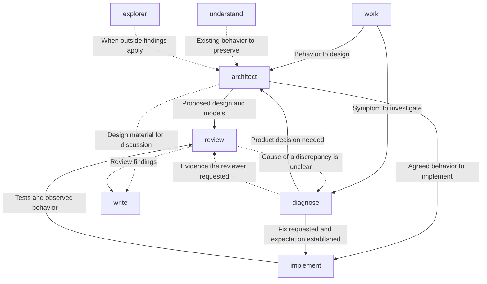

# Loom

Loom is a Claude Code and Codex plugin for software development. It organizes investigation, design and implementation around scenarios whose outcomes users can verify.

[English](README.md) | [한국어](README.ko.md)

## Install and use

Claude Code:

```bash
claude plugin marketplace add grapgrap/loom
claude plugin install loom@loom-marketplace
```

Codex:

```bash
codex plugin marketplace add grapgrap/loom
codex plugin add loom@loom-marketplace
```

Start a new session so the installed skills are available. Invoke `/loom:work` in Claude Code or `$loom:work` in Codex.

## Skills

| Skill                                            | Responsibility                                                                               |
| ------------------------------------------------ | -------------------------------------------------------------------------------------------- |
| [`$loom:work`](skills/work/SKILL.md)             | Set completion criteria, choose the skills the task needs, and verify the requested outcome. |
| [`$loom:understand`](skills/understand/SKILL.md) | Trace domain responsibilities and interactions through existing code.                        |
| [`$loom:diagnose`](skills/diagnose/SKILL.md)     | Reproduce reported symptoms and identify their causes.                                       |
| [`$loom:explorer`](skills/explorer/SKILL.md)     | Explore products, docs, and code to refine questions and compare approaches.                 |
| [`$loom:architect`](skills/architect/SKILL.md)   | Agree on designs by checking domain models with TypeScript and flows with TLA+ and TLC.      |
| [`$loom:implement`](skills/implement/SKILL.md)   | Implement and verify one scenario at a time with Red → Green → Refactor.                     |
| [`$loom:review`](skills/review/SKILL.md)         | Find missing or unjustified test expectations and trace who makes each decision in the code. |
| [`$loom:write`](skills/write/SKILL.md)           | Write and edit explanations and documents for their audience.                                |

### How the skills work together

`work` uses the user's completion criteria to choose the next step. When a change calls for a design decision, `architect` helps the user agree on the behavior through prose and diagrams. A user report or a failing test can lead straight to `diagnose`. If the user asks only for reproduction, the result is the conditions they can repeat and what they should observe.



`understand` identifies the behavior existing callers rely on. `explorer` checks which assumptions from outside sources matter to the decision. `write` uses the same domain terms to communicate design decisions and review findings. `work` compares the results with the original completion criteria and reports what was verified and which decisions remain open.

## Migrating from 2.x

Update reference research calls from `$loom:explore` to `$loom:explorer`. Start behavior changes with `$loom:work`. Use `$loom:diagnose` to reproduce or investigate a defect. When the user asks for a fix and the existing contract is clear, `$loom:implement` restores that behavior. If the fix needs a new contract or a change in responsibilities, use `$loom:architect` first. Version 3.0 removes the standalone `$loom:verify`, `$loom:coordinate` and `$loom:orchestrate` skills.
