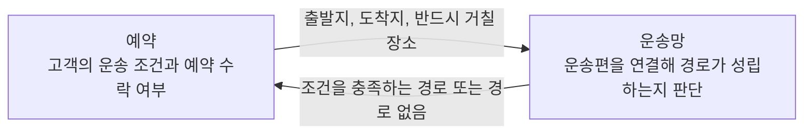

# 화물 예약을 확정할 수 있는 조건

**전략적 설계 합의서 예시 · 검토본**

고객이 지정한 경유지를 지키는 운송 경로가 있고, 해당 화물을 더 받아도 예약 한도를 지킬 수 있을 때 예약을 확정한다. **운송망은 경로의 성립을 판단하고, 예약은 그 판단에 기대어 고객에게 예약 확정을 약속한다.** 아래는 이 두 조건이 쟁점인 화물 예약에 대한 설계안이다.

## 예약과 운송망의 컨텍스트 맵



**경계에서 보존할 의미.** 고객이 고베를 통관지로 지정하면 예약은 이를 운송망에 ‘반드시 고베를 경유해야 한다’는 조건으로 전달한다. 반대로 운송망이 제시한 경로에 고베가 있다는 사실만으로 고객의 통관지 지정 여부를 알 수는 없다. 고객의 지정은 예약에서 확인한다.

## 두 담당자가 같은 결론에 도달해야 하는 사례

고객이 부산에서 오사카로 보내는 화물의 통관지로 고베를 지정했다. 아래의 ‘한도’는 이번 화물까지 포함한 예약 총량에 적용한다.

| 운송망이 확인한 사실           | 예약 한도 | 예약이 고객에게 약속할 수 있는 결과              |
| ------------------------------ | --------- | ------------------------------------------------ |
| 고베를 경유하는 경로가 있다    | 한도 이내 | 해당 경유 조건으로 예약을 확정한다.              |
| 고베를 경유하는 경로가 있다    | 한도 초과 | 경로는 성립하지만 예약은 거절한다.               |
| 고베를 거치지 않는 경로만 있다 | 한도 이내 | 필수 경유 조건을 충족할 수 없어 예약을 거절한다. |
| 고베를 거치지 않는 경로만 있다 | 한도 초과 | 두 조건을 모두 충족하지 못해 예약을 거절한다.    |

**다시 협의할 때.** 예약이 초과예약 허용량을 바꾸면 예약 한도를 다시 판단한다. 운송망이 필수 경유지를 선택 경유지로 취급하려 한다면 고객에게 약속할 수 있는 여정 자체가 바뀌므로 두 담당자가 경계의 약속을 다시 합의한다.

## 합의에 사용할 검증 근거

**도메인.** [TypeScript 모델](booking/domain.ts)은 고객의 고베 지정에서 운송망의 필수 경유 조건을 만든다. 타입 검사는 여정에 고베가 있다는 사실만으로 고객 지정을 대신할 수 없고, 경로를 찾았다는 판단만으로 예약 확정을 대신할 수 없음을 확인한다. 경유지와 지정 통관지를 같은 타입으로 바꾼 사본에서는 첫 번째 검사가 실패했다.

**흐름.** [TLA+ 명세](booking/BookingFlow.tla)와 [TLC 설정](booking/BookingFlow.cfg)으로 경로와 한도를 어느 쪽부터 확인하든 확정에는 두 근거가 모두 있고 거절에는 적어도 한 근거가 있는지 검사했다. TLC가 탐색한 13개 상태에서 위 표와 같은 네 가지 최종 상태를 확인했다. 한도 조건을 빼 본 사본에서는 ‘경로 있음 → 한도 초과 → 예약 확정’이 반례로 나왔다.

**적용 범위.** 예약 한 건에 대해 각 담당자가 한 번씩 판단하고 두 결과를 모은 뒤 결정하는 모델이다. 운송망의 경로 탐색과 한도 계산 결과는 주어진 사실로 취급한다. 계속 수행할 수 있는 판단이 언젠가 수행된다는 가정에서 예약이 결국 확정 또는 거절됨도 확인했다.

**재검증.** TypeScript 5.9.3과 TLC 2.19로 확인했다. 저장소 루트에서 `TLA2TOOLS_JAR`를 로컬 `tla2tools.jar`의 절대 경로로 지정한 뒤 실행한다.

```sh
cd examples/booking
tsc --strict --noEmit domain.ts
java -cp "$TLA2TOOLS_JAR" tlc2.TLC -config BookingFlow.cfg BookingFlow.tla
```

**확정할 내용.** 경로를 판단하는 주체, 예약을 수락하는 주체, 고베 경유의 의미, 위 네 사례의 고객 결과가 함께 검토 대상이다. 이 예시의 해운 조건은 설명을 위한 가정이다.
